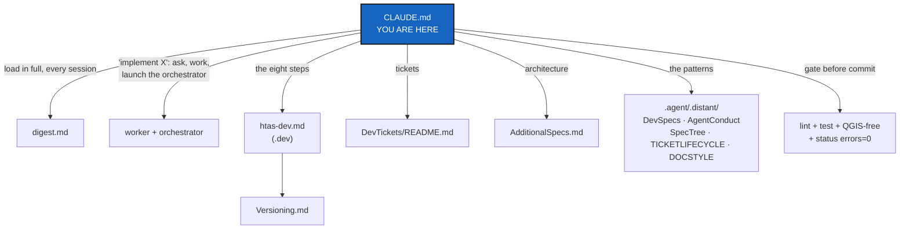

# HydrologicalTwinAlphaSeries

*Created: 2026-11-19*

*Fills in: ../../.distant/dev-sync/SpecTree.md*

## Abstract — read this first

**What this document is.** The map for anyone, human or coding agent,
doing development work in this repo: what to load first, where each kind of
rule lives, and the titles of the eight steps that finish a change. It holds
no command and no rule that is stated elsewhere.

**Why it exists.** Every agentic topic has a shared *pattern* in
`.agent/.distant/` and, where this project makes a choice, one short
*fill-in* in `.agent/.local/` that opens with a `*Fills in:*` line
([SpecTree.md](../../.distant/dev-sync/SpecTree.md) §2). This file is the
way in. It was seeded from ComplexGitSync's on 2026-11-19 and adapted.

**What you will find.** What the project is, the developer install, the
layout of the two levels, what to do when the owner says
`implement <ticket>`, the eight checklist steps, and the few rules that
have no other home.

**Who it is for.** Anyone changing code or docs in this repo. End users go
through CaWaQS-ViZ and [README.md](../../../README.md).

**What you need to do with it.** **Load [digest.md](../.localSpec/digest.md)
in full, now:** it is every `MUST`/`NEVER` rule this spec tree states, one
line each. Then follow the steps below, and read the fill-in a step points
to.

---

HydrologicalTwinAlphaSeries (HTAS) is the standalone scientific backend of
CaWaQS-ViZ: it structures CaWaQS simulation outputs, computes on them and
exposes the `HydrologicalTwin` facade and the `HydrologicalTwinClient`. It
holds no user interface and no QGIS code. User-facing overview:
[README.md](../../../README.md).

## Layout — the developer install and the two levels

- **`.config/htas-dev-beta.cgs`** is the developer install on `HT-BETA`: the
  project, its documentation (`docs/hydrological_twin`), ComplexGitSync as a
  read-only tool, the `.omniscience` ledger, `.memory` at `.cgitsync`, and
  every agentic mount. Its header lists the install commands; the checklist
  is in [htas-dev.md](../.dev/htas-dev.md). `htas-beta.cgs` at the root is
  the earlier install, without the agentic mounts.
- `src/HydrologicalTwinAlphaSeries/` source; `tests/unit/`,
  `tests/integration/`; `docs/` (Markdown) and `docs/hydrological_twin/`
  (LaTeX user guide, its own repository).
- **`.agent/`** is a plain directory, never a repository.
  [AgenticManifest.md](../.localSpec/AgenticManifest.md) is the one list of
  its mounts and spec files. The path answers "may I edit this?":

| Under | Mount | Holds |
|---|---|---|
| `.agent/.distant/` — shared, **read-only** | `dev-sync` | [DevSpecs.md](../../.distant/dev-sync/DevSpecs.md), [AgentConduct.md](../../.distant/dev-sync/AgentConduct.md), [Versioning.md](../../.distant/dev-sync/Versioning.md), [SpecTree.md](../../.distant/dev-sync/SpecTree.md), the [AGENT.md](../../.distant/dev-sync/AGENT.md) template, [AgentDataContract.md](../../.distant/dev-sync/AgentDataContract.md) |
| | `ticket` | [TICKETLIFECYCLE.md](../../.distant/ticket/TICKETLIFECYCLE.md) |
| | `documentation` | [DOCSTYLE.md](../../.distant/documentation/DOCSTYLE.md) |
| `.agent/.local/` — **ours to write** | `.claude` | this file and `AGENT.md`, a pointer stating the reading order |
| | `.localSpec` | [AdditionalSpecs.md](../.localSpec/AdditionalSpecs.md) (layers, import rules), [AGENT.md](../.localSpec/AGENT.md) (roles), [audit.md](../.localSpec/audit.md), [digest.md](../.localSpec/digest.md) |
| | `.dev` | [README.md](../.dev/README.md): the checklist ([htas-dev.md](../.dev/htas-dev.md)), [Versioning.md](../.dev/Versioning.md), and [DevTickets/](../.dev/DevTickets/README.md) — **private**; the public repository holds no tickets |

`CLAUDE.md` and `AGENT.md` at the project root are symbolic links into
`.agent/.local/.claude/`. The `ComplexGitSync/` checkout is the tool, on
`CGS-ALPHA`: never edit it from this tree.

## When the owner says `implement <ticket>`

These are orders, not a description, and they come before the eight steps.
Do them in this order.

1. **`implement <ticket>` is the explicit request for a subagent** that the
   harness's Agent tool asks for. Launching the orchestrator is not
   optional and needs no further permission.
2. **Read the ticket, then ask every open *Decisions for the owner* with
   `AskUserQuestion` before the first edit.** A recommendation is never the
   answer.
3. **Implement as the worker**: code, tests, docs, `pixi run bump-build`. **Never** run `cgitsync version bump`
   or `bump-version`, write a self-history record, or score your own work.
4. **Launch the orchestrator with the Agent tool, in the foreground.** Give
   it the ticket's name, every repository the diff touches, and the
   owner's answers. Tell it to quote the work against the eight steps,
   decide the version level, run `cgitsync version bump <level>` from the
   tree's root, and write the record with
   `cgitsync self-history add`. Tell it to propose **one** commit message,
   to be used unchanged in every repository the diff touches.
5. **Fix every defect it reports, then send the work back to the same
   orchestrator** for a re-quote. Repeat until it reports no blocking
   defect.
6. **Only then archive the ticket and deliver the commit message.**

Drafting, ranking or closing a ticket is orchestration already and
launches nobody. Why the pair exists:
[AgentConduct.md](../../.distant/dev-sync/AgentConduct.md) §4 and §4.1. This
block restates §4.1 on purpose: the orders bind only in the file every
session loads.

## When the owner says `implement "CORR: @agent-dev"`

A file whose first line is `CORR:` or `CORRection:`, followed by
`@agent-dev` (or `@dev-agent`), holds a correction the owner left in the
file itself.

1. **Find every one in the current Operating Space**: every repository of
   the tree, never `.git/` or `.pixi/`.
2. **Resolve each as written**, in its own file. A `CMD:` line is a
   command. Ask with `AskUserQuestion` what a note leaves open, before the
   first edit.
3. **Remove the header and the note once resolved.** The file must be valid
   for its format again.
4. **If a resolution changes `src/`, it is an `implement`**, with the orders
   above. Otherwise run the gates (lint, test, `status`) and deliver the
   commit message yourself.
5. **List each correction and its resolution** in the report.

## Before committing — the eight steps

Do all of them as part of the change, not as a follow-up. **Each step's
command and detail are in [htas-dev.md](../.dev/htas-dev.md)**; the shape
and the reason are [AgentConduct.md](../../.distant/dev-sync/AgentConduct.md) §1.
HTAS is laid out as ComplexGitSync is: `pixi.toml` holds the version,
`pyproject.toml` the build.

1. `pixi run lint` and `pixi run test` must both pass, and no `qgis`/`PyQt` import under `src/`.
2. `pixi run bump-build` for any change under `src/`.
3. `cgitsync status`, run from this tree's own root, must show `errors=0`.
4. `cgitsync version bump {patch,minor,major}` (it runs `pixi run bump-version`) for every change under `src/`, `patch` at least; never hand-edit a version field, and CI never writes one.
5. Rebuild the user guide after every bump and every change to `docs/hydrological_twin`.
6. Update `AdditionalSpecs.md`'s layer table if a responsibility moved between layers.
7. Document a new public method in `docs/api_capabilities.md` and `docs/api_examples.md`; never as a table in `README.md`.
8. Deliver **one** commit message (`HydrologicalTwinAlphaSeries-<version>`, three lines), used unchanged in every repository touched; never push without being asked.

The plans are in [DevTickets/](../.dev/DevTickets/README.md). The
attribution rules (an agent is never credited on a commit; the public front
uses `vendor-name` and `model-name`) are filled in in
[htas-dev.md](../.dev/htas-dev.md).

## Architecture boundary

The layers (L1 `ht/client` → L2 `ht/developer` → L3 `services` → `domain`
→ `config`/`tools`), the import rules, the public interface and the
QGIS-free rule are in [AdditionalSpecs.md](../.localSpec/AdditionalSpecs.md).
Data flow: `CaWaQS-ViZ → HydrologicalTwinClient → operations_client →
HydrologicalTwin (8 macro-verbs) → services → Compartment → CaWaQS output
files`.

## Document conventions

Follow [DOCSTYLE.md](../../.distant/documentation/DOCSTYLE.md) for every
Markdown document in the private spec tree: abstract first, mermaid graph,
audience separation, one authoritative file per purpose. Every created
document opens with a `*Created: YYYY-MM-DD*` line, and a local spec with a
`*Fills in:*` line. The root `README.md` is the user's front page and opens
with the project's name and purpose instead. The public `docs/*.md` predate
this spec tree; bring one to DOCSTYLE when a change rewrites it, not as a
side effect of another change.

Planning tickets carry a filename lifecycle and a `*Branch:*` line, both in
[TICKETLIFECYCLE.md](../../.distant/ticket/TICKETLIFECYCLE.md); this
project's branches and prefixes are in
[DevTickets/README.md](../.dev/DevTickets/README.md).
