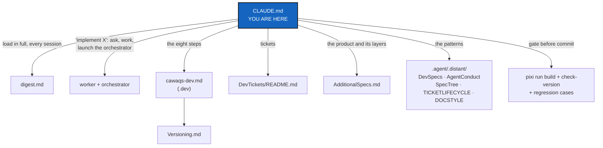

# CaWaQS

*Created: 2026-08-31*

*Fills in: ../../.distant/dev-sync/SpecTree.md*

## Abstract — read this first

**What this document is.** The map for anyone — human or coding agent —
doing development work in this repo: what to load first, where each kind of
rule lives, and the titles of the eight steps that finish a change. It holds
no command and no rule that is stated elsewhere.

**Why it exists.** Every agentic topic has a shared *pattern* in
`.agent/.distant/` and, where this project makes a choice, one short
*fill-in* in `.agent/.local/` that opens with a `*Fills in:*` line
([SpecTree.md](../../.distant/dev-sync/SpecTree.md) §2). This file is the way
in.

**What you will find.** What the project is, the layout of the two levels,
what to do when the owner says `implement <ticket>`, the eight checklist
steps, and the few rules that have no other home.

**Who it is for.** Anyone changing code or docs in this repo. End users only
need [README.md](../../../README.md); this file is for development.

**What you need to do with it.** **Load [digest.md](../.localSpec/digest.md)
in full, now:** it is every `MUST`/`NEVER` rule this spec tree states, one
line each, short enough to read in a session's opening moments. Then follow
the steps below, and read the fill-in a step points to.

---

CaWaQS (CAtchment WAter Quality Simulator) is a physically based coupled
surface–subsurface model written in C (with flex, bison and one Fortran
file), built on 17 libraries. User-facing docs and installation:
[README.md](../../../README.md). **CaWaQS never depends on ComplexGitSync**:
it installs and builds with git, bash, gcc and make alone. ComplexGitSync is
a development tool of this Operating Space only.

## Layout — the product and the Operating Space

- The cawaqs root holds `src/` (the C sources of cawaqs, its `Makefile`,
  `param_caw.h`, the install scripts `make_Cawaqs*.sh`), `docs/`, `pixi.toml`
  (the one SemVer of CaWaQS), `CITATION.cff`, `install.sh` and `README.md`.
- `src/lib*` are the 17 libraries, each its own repository, and `src/scripts`
  is the `scripts` repository (the library list `list_all.dat`, the install
  and build helpers). In a development workspace, the cawaqs root is on the
  bare branch `4X` and every other repository on `cawaqs_4X`. The layers
  and the frontier between `scripts`, `.dev` and ComplexGitSync are in
  [AdditionalSpecs.md](../.localSpec/AdditionalSpecs.md).
- **`.agent/`** is a plain directory, never a repository.
  [AgenticManifest.md](../.localSpec/AgenticManifest.md) is the one list of
  its mounts and spec files. The path answers "may I edit this?":

| Under | Mount | Holds |
|---|---|---|
| `.agent/.distant/` — shared, **read-only** | `dev-sync` | [DevSpecs.md](../../.distant/dev-sync/DevSpecs.md), [AgentConduct.md](../../.distant/dev-sync/AgentConduct.md), [Versioning.md](../../.distant/dev-sync/Versioning.md), [SpecTree.md](../../.distant/dev-sync/SpecTree.md), the [AGENT.md](../../.distant/dev-sync/AGENT.md) template, [AgentDataContract.md](../../.distant/dev-sync/AgentDataContract.md) |
| | `ticket` | [TICKETLIFECYCLE.md](../../.distant/ticket/TICKETLIFECYCLE.md) |
| | `documentation` | [DOCSTYLE.md](../../.distant/documentation/DOCSTYLE.md) |
| `.agent/.local/` — **ours to write** | `.claude` | this file and `AGENT.md`, a pointer stating the reading order |
| | `.localSpec` | [AdditionalSpecs.md](../.localSpec/AdditionalSpecs.md) (the product, its layers, the version rules), [AGENT.md](../.localSpec/AGENT.md) (roles), [audit.md](../.localSpec/audit.md), [digest.md](../.localSpec/digest.md) |
| | `.dev` | [README.md](../.dev/README.md): the checklist ([cawaqs-dev.md](../.dev/cawaqs-dev.md)), [Versioning.md](../.dev/Versioning.md), the private `scripts/versioning.py`, and [DevTickets/](../.dev/DevTickets/README.md) — **private**; the public repository holds no tickets |

`CLAUDE.md` and `AGENT.md` at the project root are symbolic links into
`.agent/.local/.claude/`.

## When the owner says `implement <ticket>`

These are orders, not a description, and they come before the eight steps
(owner, 2026-10-09, PairRuleGate). Do them in this order.

1. **`implement <ticket>` is the explicit request for a subagent** that the
   harness's Agent tool asks for. Launching the orchestrator is not
   optional and needs no further permission.
2. **Read the ticket, then ask every open *Decisions for the owner* with
   `AskUserQuestion` before the first edit.** A recommendation is never the
   answer.
3. **Implement as the worker**: code, tests, docs, and `pixi run bump-build
   <lib>` for each library whose `src/` you changed. **Never** run
   `bump-version`, write a self-history record, or score your own work.
4. **Launch the orchestrator with the Agent tool, in the foreground.** Give
   it the ticket's name, every repository the diff touches, and the
   owner's answers. Tell it to quote the work against the eight steps,
   decide the version level, run `pixi run bump-version`, and write the
   record. Tell it to propose **one** commit message, `cawaqs-<SemVer>`, to
   be used unchanged in every repository the diff touches.
5. **Fix every defect it reports, then send the work back to the same
   orchestrator** for a re-quote. Repeat until it reports no blocking
   defect.
6. **Only then archive the ticket and deliver the commit message.**

Drafting, ranking or closing a ticket is orchestration already and
launches nobody. Why the pair exists:
[AgentConduct.md](../../.distant/dev-sync/AgentConduct.md) §4 and §4.1.

## When the owner says `implement "CORR: @agent-dev"`

These are orders too (owner, 2026-10-29). A file whose first line is `CORR:` or `CORRection:`, followed by
`@agent-dev` (the owner also writes `@dev-agent`), holds a correction the owner left in the file itself.

1. **Find every one in the current Operating Space**: every repository of the tree, never `.git/` or `.pixi/`.
2. **Resolve each as written**, in its own file. A `CMD:` line is a command. Ask with `AskUserQuestion`
   what a note leaves open, before the first edit.
3. **Remove the header and the note once resolved.** The file must be valid for its format again.
4. **If a resolution changes `src/`, it is an `implement`**, with the orders above. Otherwise run the gates
   and deliver the commit message yourself.
5. **List each correction and its resolution** in the report, so the owner can check every one.

## Before committing — the eight steps

Do all of them as part of the change, not as a follow-up. **Each step's
command and detail are in [cawaqs-dev.md](../.dev/cawaqs-dev.md)**; the
shape and the reason are [AgentConduct.md](../../.distant/dev-sync/AgentConduct.md) §1.

1. `pixi run build` must succeed with no new warning, and the regression cases must run.
2. `pixi run bump-build <lib>` for each library whose `src/` changed.
3. `cgitsync status`, run from this tree's own root, must show `errors=0`.
4. `pixi run bump-version {major,minor,patch}` once per change, by the orchestrator; regular SemVer unless the owner states an exception for the release.
5. Docs: the PDF documentation is mounted by the owner later; until then, update the README and `CITATION.cff` only through `bump-version`.
6. Update `AdditionalSpecs.md` if a layer, a version rule or the frontier moved.
7. Document any new option of an install script in `README.md`'s install tables, which are the user's page.
8. Deliver **one** commit message (`cawaqs-<SemVer>`, three lines), used unchanged in every repository touched; never push without being asked.

`pixi run check-version` must pass before step 8. The plans are in
[DevTickets/](../.dev/DevTickets/README.md). An agent is never credited on a
commit; the attribution rules are filled in in
[cawaqs-dev.md](../.dev/cawaqs-dev.md).

## Architecture boundary

The product's layers, the single-implementation rules (one build in
`scripts/build_tree.sh` once `scripts` 1.0.0 lands, one SemVer in
`pixi.toml`, a library's build kept in its own `Makefile` and `param_*.h`)
and the version rules are in [AdditionalSpecs.md](../.localSpec/AdditionalSpecs.md).

## Document conventions

Follow [DOCSTYLE.md](../../.distant/documentation/DOCSTYLE.md) for every
Markdown document in this repo — abstract first, mermaid graph, audience
separation, length, one authoritative file per purpose. Every created
document opens with a `*Created: YYYY-MM-DD*` line, and a local spec with a
`*Fills in:*` line. **One exception (owner, 2026-10-02): the project's root
`README.md`**, the user's front page. Every other Markdown document follows
DOCSTYLE §1. No document names a person.

Planning tickets carry a filename lifecycle and a `*Branch:*` line, both in
[TICKETLIFECYCLE.md](../../.distant/ticket/TICKETLIFECYCLE.md); this
project's branches and prefixes are in
[DevTickets/README.md](../.dev/DevTickets/README.md).
