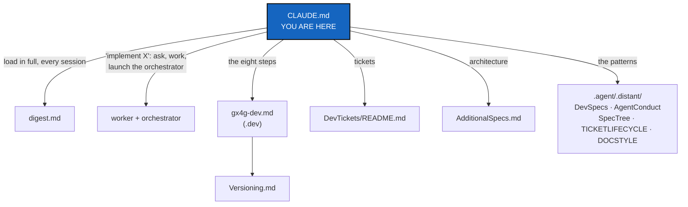

# GX4G

*Created: 2026-10-27*

*Fills in: ../../.distant/dev-sync/SpecTree.md*

## Abstract — read this first

**What this document is.** The map for anyone, human or coding agent,
doing development work on GX4G: what to load first, where each kind of rule
lives, and the titles of the eight steps that finish a change. It holds no
command and no rule stated elsewhere.

**Why it exists.** Every agentic topic has a shared *pattern* in
`.agent/.distant/` and, where GX4G makes a choice, one short *fill-in* in
`.agent/.local/` that opens with a `*Fills in:*` line
([SpecTree.md](../../.distant/dev-sync/SpecTree.md) §2). This file is the
way in.

**What you will find.** What GX4G is, the two specs and the two levels,
what to do when the owner says `implement <ticket>`, the eight checklist
steps, and the architecture boundary.

**Who it is for.** Anyone changing code or docs in this repository. Users
only need [README.md](../../../README.md).

**What you need to do with it.** **Load [digest.md](../.localSpec/digest.md)
in full, now.** It is every `MUST`/`NEVER` of this spec tree, one line each.
Then follow the steps below, and read the fill-in a step points to.

---

GX4G is the gate of a ComplexGitSync Operating Space: a Rust library today,
`pixi run gx4g` once EnvConnect E0 lands. It decides what a request may
reach (the proof vector `*OP.poe` and its four rings), holds the project's
entry in the Omniscience register, and will manage host rights. It never
edits ComplexGitSync and calls `pixi run cgitsync` like any user. The
specification on one page is [GX4G.md](../../../GX4G.md); the reference is
[doc/MASTER.pdf](../../../doc/MASTER.pdf).

## Layout — two specs and two levels

| Spec | Install | Mounts |
|---|---|---|
| `install.cgs` (root) | USER | gx4g, and ComplexGitSync as a leaf |
| `examples/gx4g4dev.cgs` | DEV | gx4g, ComplexGitSync's developer tree, the `.agent/` mounts and `.omniscience`. The only `.cgs` in `examples/`. Opening it as a whole is blocked until ComplexGitSync's NestedAgentMaster lands; its `.agent/` entries are mounted by hand meanwhile |

- `src/` the kernel, `tests/` its tests, `examples/` the phase examples and
  the specs, `doc/` the LaTeX book with its built PDFs, `tutorials/`.
- **`.agent/`** is a plain directory, ignored by Git, never a repository.
  [AgenticManifest.md](../.localSpec/AgenticManifest.md) is the one list of
  its mounts and spec files. The path answers "may I edit this?":

| Under | Mount | Holds |
|---|---|---|
| `.agent/.distant/`, shared, **read-only** | `dev-sync` | [DevSpecs.md](../../.distant/dev-sync/DevSpecs.md), [AgentConduct.md](../../.distant/dev-sync/AgentConduct.md), [Versioning.md](../../.distant/dev-sync/Versioning.md), [SpecTree.md](../../.distant/dev-sync/SpecTree.md), the [AGENT.md](../../.distant/dev-sync/AGENT.md) template |
| | `ticket` | [TICKETLIFECYCLE.md](../../.distant/ticket/TICKETLIFECYCLE.md) |
| | `documentation` | [DOCSTYLE.md](../../.distant/documentation/DOCSTYLE.md) |
| `.agent/.local/`, **ours to write**, branch `gx4g` | `.claude` | this file and [AGENT.md](AGENT.md), the reading order |
| | `.localSpec` | [AdditionalSpecs.md](../.localSpec/AdditionalSpecs.md) (architecture), [AGENT.md](../.localSpec/AGENT.md) (roles), [audit.md](../.localSpec/audit.md), [digest.md](../.localSpec/digest.md) |
| | `.dev` | [gx4g-dev.md](../.dev/gx4g-dev.md) (the checklist), [Versioning.md](../.dev/Versioning.md), [RustGuide.md](../.dev/RustGuide.md) (the architecture in diagrams), and [DevTickets/](../.dev/DevTickets/README.md), **private** |

`CLAUDE.md` and `AGENT.md` at the project root are symbolic links into
`.agent/.local/.claude/`.

## When the owner says `implement <ticket>`

These are orders, not a description, and they come before the eight steps.
Do them in this order.

1. **`implement <ticket>` is the explicit request for a subagent** that the
   harness's Agent tool asks for. Launching the orchestrator is not optional
   and needs no further permission.
2. **Read the ticket, then ask every open decision for the owner with
   `AskUserQuestion` before the first edit.** A recommendation is never the
   answer.
3. **Implement as the worker**: code, tests, docs, and the build counter.
   **Never** bump the release version, write the orchestrator's record, or
   score your own work.
4. **Launch the orchestrator with the Agent tool, in the foreground.** Give
   it the ticket's name, every repository the diff touches, and the owner's
   answers. Tell it to quote the work against the eight steps, decide the
   release level and bump it, rebuild the PDFs, append its record to the
   ticket ([gx4g-dev.md](../.dev/gx4g-dev.md), *The pair rule*), and propose
   **one** commit message for every repository the diff touches.
5. **Fix every defect it reports, then send the work back to the same
   orchestrator.** Repeat until it reports no blocking defect.
6. **Only then archive the ticket and deliver the commit message.**

Drafting, ranking or closing a ticket is orchestration already and launches
nobody ([AgentConduct.md](../../.distant/dev-sync/AgentConduct.md) §4).

## Before committing — the eight steps

Each step's command is in [gx4g-dev.md](../.dev/gx4g-dev.md); the shape and
the reason are [AgentConduct.md](../../.distant/dev-sync/AgentConduct.md) §1.

1. Format, clippy and the full test suite pass.
2. Bump the build counter for any change under `src/`.
3. The tree's own status: not applicable until `pixi run gx4g` exists.
4. Bump the release version after every build bump, `patch` at least.
5. Rebuild the PDFs after every version bump and every docs change.
6. Update `AdditionalSpecs.md` if a module's responsibility moved.
7. Document what a user sees in `doc/`, the tutorials and the README's *What works today*.
8. Deliver **one** commit message (`gx4g-<version>`, three lines at most), used unchanged in every repository touched. Never push without being asked.

## Architecture boundary

The kernel's phases, the gate's rules (the X–OP frontier, `*OP.poe`, the
rings, `.omniscience`, `H_project` provided by cgitsync) and what GX4G never
does to ComplexGitSync are in
[AdditionalSpecs.md](../.localSpec/AdditionalSpecs.md).

## Document conventions

Follow [DOCSTYLE.md](../../.distant/documentation/DOCSTYLE.md) for every
Markdown document: abstract first, a mermaid graph, plain English, one
authoritative file per purpose. Every created document opens with a
`*Created: YYYY-MM-DD*` line, and a fill-in with a `*Fills in:*` line.
**One exception: the root `README.md`**, the user's front page, which
opens with the tool's name and what it is for. Statements of design that
are not built yet are marked `\planned` in `doc/` and "designed" in the
README. Tickets follow
[TICKETLIFECYCLE.md](../../.distant/ticket/TICKETLIFECYCLE.md); GX4G's
branches are in [DevTickets/README.md](../.dev/DevTickets/README.md).
